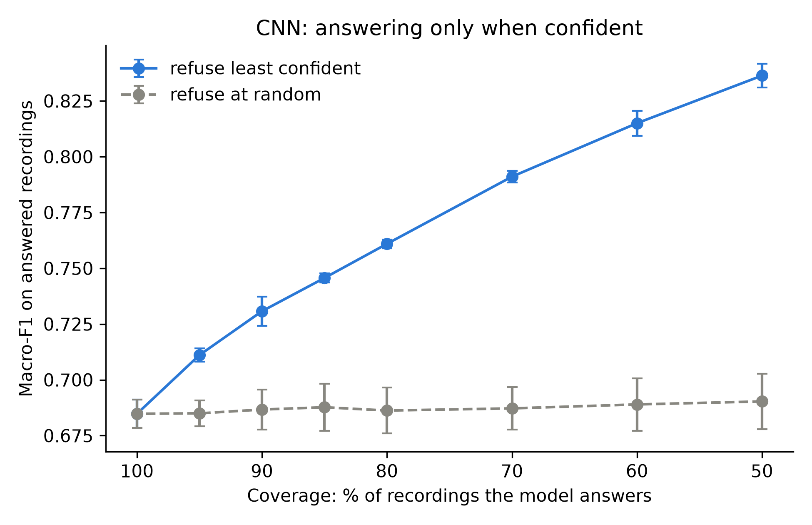
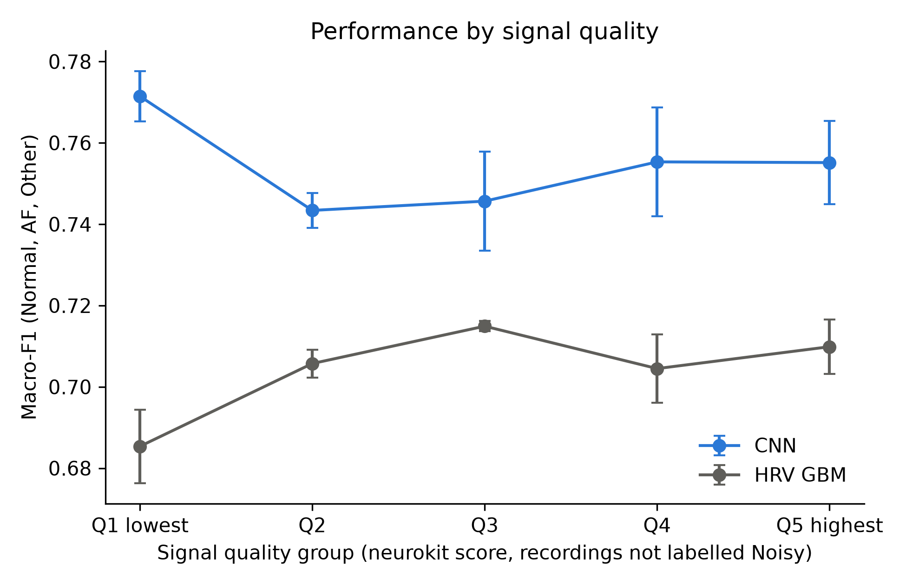

# When Can a Wearable ECG Be Trusted? Atrial Fibrillation Detection and Signal Quality on Real-World Recordings

**Status: work in progress.** The data pipeline, baselines, CNN and signal quality analyses below are complete and reproducible. Further analyses are listed in [Next steps](#next-steps).

## Summary

Consumer ECG devices let people record their own heart rhythm, but the recordings are short, single-lead and often noisy. This project asks two questions on 8,526 real-world recordings from a handheld device: can atrial fibrillation (AF) be detected reliably, and **when should a prediction not be trusted?**

**Main findings:**
- A 1D CNN on the raw signal outperformed a classifier on heart rate variability (HRV) features (macro-F1 0.682 vs 0.598), with the largest gain on **noise detection** (F1 0.483 vs 0.316).
- The same network improved from 0.632 to 0.682 macro-F1 **only by changing how it was trained**, after learning curves revealed unstable training.
- **The CNN knows when it is unsure:** answering only its 80% most confident recordings raises macro-F1 from 0.685 to 0.761, while refusing the same number at random changes nothing. The refused recordings are not only noisy ones: hard AF and Other rhythms are refused too.
- The dataset itself is messy: **5% of expert labels were corrected** between versions, mostly into the "too noisy" class, and **recording length alone partly predicts the noisy label**. The CNN's noise detection does not rely on this length bias.

## Data

**Source:** PhysioNet/Computing in Cardiology Challenge 2017, *AF Classification from a Short Single Lead ECG Recording* (Clifford et al. 2017), public training set, labels version 3. A hidden test set of 3,658 recordings was not released, so all evaluation uses cross-validation.

- **Device:** AliveCor handheld ECG, recordings made by patients themselves
- **Signal:** one lead, 300 Hz, already band-pass filtered by the device
- **Length:** 9 to 61 s, most recordings 30 s

| Class | Recordings | Share |
|---|---|---|
| Normal rhythm | 5,074 | 60% |
| Other rhythm | 2,415 | 28% |
| Atrial fibrillation | 758 | 9% |
| Too noisy to classify | 279 | 3% |

8,528 recordings, of which 2 exact duplicates were removed (8,526 kept).

### What the data showed before any modelling

| Finding | Evidence |
|---|---|
| Expert labels are uncertain | 412 labels (5%) changed between label versions v0 and v3 |
| The "too noisy" boundary is the least reliable label | 233 of the 412 corrections moved recordings **into** Noisy |
| AF and Other rhythm are easily confused | 101 corrections between them, against only 28 between Normal and AF |
| Recording length partly predicts noise | Noisy recordings average 24 s (others 32 to 34 s); a model using **only length** reaches F1 0.215 on Noisy (chance ≈ 0.03) |
| Noise mimics AF in HRV features | False R peaks make RR intervals irregular: Noisy recordings have the highest HRV variability of all classes |
| A generic quality score barely separates noisy recordings | neurokit2 quality: 0.70 for Noisy vs 0.74 for other classes |

### Processing decisions

| Decision | Reason |
|---|---|
| Trim 1 s at the start and end of each recording | Edge effects and hand placement disturbances |
| Remove exact duplicate recordings (2 pairs) | Avoid the same recording appearing in training and test |
| 7 s windows, non-overlapping, for the CNN | The longest window that fits every recording after trimming: none dropped, none padded |
| Normalize each window on its own | Amplitude depends on how the device is held, not on the rhythm |
| Recording prediction = average of its window probabilities | The model never sees the recording length |
| Recording length and number of beats excluded from all features | Avoid the length shortcut |

## Methods

### Evaluation protocol

- **Stratified 5-fold cross-validation, repeated with 3 seeds** (15 splits), at **recording level**: all windows of a recording stay in the same fold. Splits are saved once and reused by every model.
- **Balanced class weights** in every model, decided before seeing results (Noisy is 3% of recordings).
- **Metrics:** macro-F1 over the 4 classes (main metric), the challenge score (mean F1 over Normal, AF and Other), and F1 per class.

### Models

| Model | Input | Description |
|---|---|---|
| **HRV logistic regression** | 8 recording-level features | RR interval variability (SDNN, RMSSD, pNN50, coefficient of variation, median absolute successive difference), share of physiologically implausible RR intervals, mean RR, neurokit2 quality score |
| **HRV gradient boosting** | same 8 features | Non-linear baseline |
| **Length only** | recording length | Not a classifier: measures the length bias |
| **1D CNN** | raw 7 s windows (2,100 samples) | 6 convolution blocks (50 ms filters, batch normalization, max pooling; receptive field about 3 s), global average pooling, linear classifier. AdamW, mini-batches of 128 |

## Results

Mean over the 15 test folds (standard deviation for macro-F1).

| Model | Macro-F1 | Challenge score | F1 Normal | F1 AF | F1 Other | F1 Noisy |
|---|---|---|---|---|---|---|
| Length only | 0.295 ± 0.009 | 0.322 | 0.688 | 0.049 | 0.230 | 0.215 |
| HRV logistic regression | 0.525 ± 0.014 | 0.604 | 0.782 | 0.606 | 0.423 | 0.289 |
| HRV gradient boosting | 0.598 ± 0.010 | 0.692 | 0.822 | 0.670 | 0.585 | 0.316 |
| **1D CNN (v3, final)** | **0.682 ± 0.026** | **0.748** | **0.855** | **0.756** | **0.632** | **0.483** |

For context only: the best 2017 challenge entries scored about 0.83 on the challenge score, on the hidden test set. These numbers are not directly comparable.

### Training procedure matters as much as the model

Same data, same network, same splits; only the training changed. Each change was based on validation learning curves.

| Version | Change | Macro-F1 | F1 AF | F1 Noisy |
|---|---|---|---|---|
| v1 | early stopping on validation loss, patience 6 | 0.632 ± 0.041 | 0.688 | 0.434 |
| v2 | patience 15 (v1 often stopped after 2 to 5 useful epochs) | 0.640 ± 0.035 | 0.710 | 0.429 |
| v3 | cosine learning-rate decay, early stopping on smoothed validation macro-F1 | **0.682 ± 0.026** | **0.756** | **0.483** |

The v2 learning curves showed overfitting after about 10 epochs, validation loss rising while validation macro-F1 stayed on a plateau (overconfidence), and predictions jumping strongly between epochs. v3 addresses both. Rerunning v1 and v2 reproduced their scores within 0.001 and 0.008 macro-F1.

### When can the prediction be trusted?

**A. Abstention.** The CNN refuses its least confident recordings (confidence = highest class probability). Scores are computed on the pooled test predictions of each seed and averaged over seeds.

| Recordings answered | Macro-F1 | Refusing at random | Noisy refused | AF refused | Other refused | Normal refused |
|---|---|---|---|---|---|---|
| 100% | 0.685 | 0.685 | 0% | 0% | 0% | 0% |
| 90% | 0.731 | 0.687 | 22% | 11% | 14% | 7% |
| 80% | 0.761 | 0.686 | 33% | 19% | 27% | 16% |
| 50% | 0.836 | 0.690 | 59% | 41% | 59% | 47% |

Confidence carries real information. But the model refuses hard rhythms as well as noisy signals, so part of the gain comes from leaving difficult cases out. In a device, refused AF recordings would lead to a new recording, not a missed diagnosis.



**B. Performance by signal quality.** Recordings labelled Normal, AF or Other, split into 5 equal groups by the neurokit2 quality score. The CNN's macro-F1 is stable across groups (0.74 to 0.77). The HRV model drops slightly in the lowest group (0.685 vs about 0.71) and raises 6 times more false "Noisy" alarms there (5.7% vs 0.9%), consistent with false R peaks. **This analysis is inconclusive overall**, because the quality score itself barely separates expert-labelled noisy recordings and also depends on the rhythm.



**C. Length shortcut check.** Among truly noisy recordings, the CNN detects 71% of normal-length ones but only 45% of short ones (under 20 s). A model using length as a shortcut would do the opposite. Short noisy recordings are harder because they give only one or two windows. **The CNN's noise detection is not driven by the length bias.**

## Limitations

- **No patient identifiers.** One person may have made several recordings that fall in different folds; only exact duplicates could be removed.
- **Labels are per recording.** A recording labelled AF or Other may contain windows without the abnormality.
- **Label noise.** 5% of labels changed between versions, especially around the noisy class; some remaining labels are probably wrong.
- **Small noisy class.** About 56 noisy recordings per test fold, so F1 Noisy varies strongly between splits (±0.08).
- **No hidden test set.** Results are cross-validation estimates and are not directly comparable with the official challenge scores.
- **Several CNN versions were trained after seeing test scores.** Each change was based on validation curves, and all versions are reported, but some selection bias cannot be fully excluded. The CNN is frozen at v3.

## Next steps

- [ ] A better signal quality measure (for example, based on beat detection agreement or signal statistics) to redo analysis B
- [ ] Use the tail of each recording with one extra end-aligned window
- [ ] Sensitivity check for same-person leakage, grouping recordings by ECG shape similarity
- [ ] Calibration analysis of the CNN's confidence
- [ ] Extension to photoplethysmography (PPG), the optical sensor in smartwatches

## Repository structure

```
├── data/                       raw and processed data (not in the repository)
├── scripts/
│   ├── 02_build_dataset.py     load, trim, remove duplicates, recording-level splits
│   ├── 03_hrv_features.py      R peak detection, HRV features, quality score
│   ├── 04_baselines.py         HRV models and length-only model
│   ├── 05_cnn.py               1D CNN, versions v1, v2, v3 (--version option)
│   └── 06_quality_analysis.py  abstention, quality groups, length check
├── notebooks/                  ECG basics and data inspection
├── results/                    metrics, predictions, learning curves
└── figures/
```

## How to reproduce

**1. Environment** (Python 3.11):
```
conda create -n ecg python=3.11
conda activate ecg
pip install -r requirements.txt
```
For GPU support, install PyTorch with the command from pytorch.org for your system.

**2. Data** (training set only, about 150 MB):
```
pip install awscli
aws s3 sync --no-sign-request s3://physionet-open/challenge-2017/1.0.0/training/ data/raw/training
```

**3. Run** from the repository root:
```
python scripts/02_build_dataset.py
python scripts/03_hrv_features.py
python scripts/04_baselines.py
python scripts/05_cnn.py --version v3
python scripts/06_quality_analysis.py
```
The CNN takes about 10 minutes on a recent GPU; the other steps take a few minutes in total.

## Author

Hicham Attioui, bioinformatics engineer. GitHub: [hicham-attioui](https://github.com/hicham-attioui)
